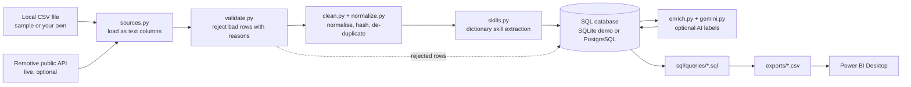

# Architecture

Plain-text version: `source -> load -> validate -> clean/dedupe -> skills -> database -> (optional AI) -> SQL queries -> CSV -> Power BI`.

## Modules

| Module | Responsibility |
|---|---|
| `config.py` | Reads environment/.env, validates every value, hides secrets |
| `logging_setup.py` | Structured text/JSON logs, secret redaction |
| `http_client.py` | One place for timeouts, bounded retries, `Retry-After` handling |
| `sources.py` | CSV loader and Remotive adapter; both return the same raw text table |
| `normalize.py` | Pure parsing helpers (dates, amounts, locations, HTML) |
| `validate.py` | Per-row checks; produces `valid` and `rejected` tables |
| `clean.py` | Normalised records, content hash, de-duplication, skill rows |
| `skills.py` | Skill catalogue and matching rules |
| `database.py` | sqlite3 / psycopg wrapper, `:name` parameters, transactions |
| `pipeline.py` | Orchestrates a run and writes the audit row |
| `gemini.py`, `enrich.py` | Optional AI labelling, never blocks ingestion |
| `reports.py` | Runs `sql/queries/*.sql` and exports CSV |
| `cli.py` | Commands: `demo`, `ingest-csv`, `ingest-remotive`, `enrich`, `report`, `init-db`, `check-config` |

## Data flow guarantees

- **Atomic runs:** all rows of one run, plus its "succeeded" status, commit in a single transaction. A failure rolls everything back and a separate transaction marks the run `failed`.
- **Idempotent reruns:** `job_id` (source + source id, or content hash) and `content_hash` are unique keys, and inserts use `ON CONFLICT DO NOTHING`. Rerunning stores nothing new.
- **Origin separation:** every row carries `data_origin` (`sample`, `user_csv`, `live`), enforced by a CHECK constraint. The demo uses its own database file.
- **AI is optional:** labels are written after ingestion has committed; any AI failure leaves stored data untouched.

## Database model

`pipeline_runs` 1--n `job_postings` n--n `skill_catalog` (through `job_skills`); `rejected_records` hangs off `pipeline_runs`. See `data-dictionary.md`.
